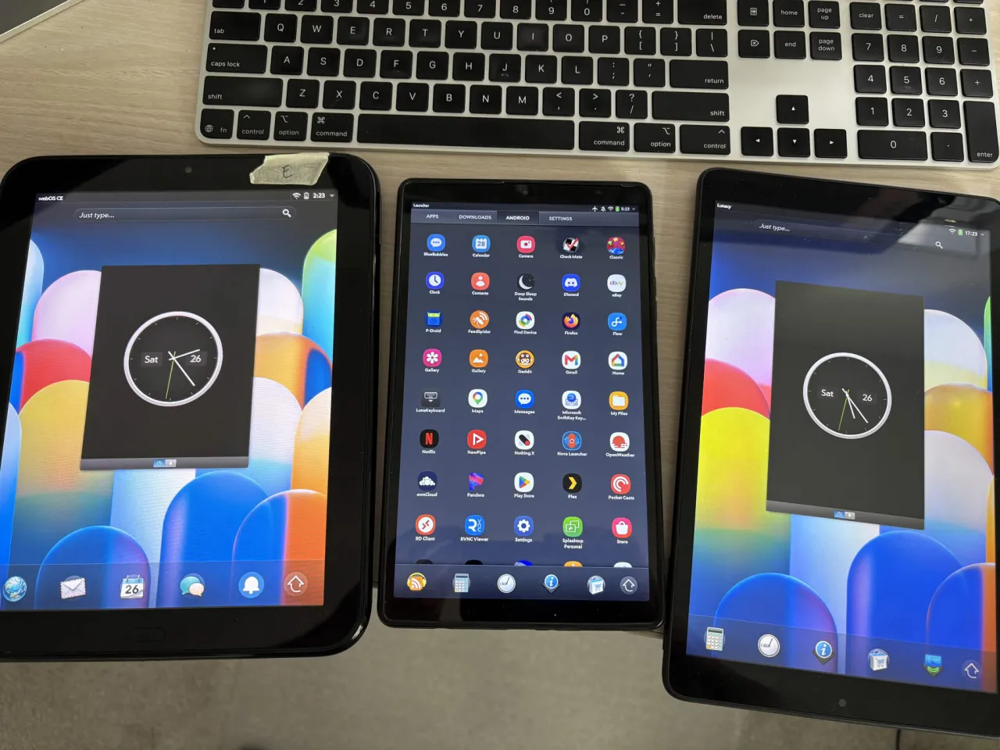

# Lunacy

**Run legacy webOS apps on modern Android phones and tablets, inside a shell that looks and
feels like webOS.**

webOS apps were HTML and JavaScript. They loaded their framework (Enyo or Mojo) from the OS,
ran as cards in the Luna system shell, and talked to the system over the Luna service bus
(`palm://…`). The devices are more than a decade old, but the apps are still good. Most of
them never needed Palm's hardware. They needed Palm's *contract*.

Lunacy provides that contract on Android.

## How it works

Lunacy re-implements the contract, not the OS:

1. **A simulated Luna shell.** A native Android UI that recreates the webOS experience: card
   view, gestures, launcher, notification banners and dashboard. None of Palm's code runs.
   It looks and behaves like webOS, and it has to feel right.
2. **Modernized frameworks.** Apps load their framework from
   `/usr/palm/frameworks/...` and trust the OS to provide it. Lunacy supplies the TouchPad's own
   [Enyo 1.0](https://github.com/enyojs/enyo-1.0) (Apache 2.0), fixed to run on a modern
   Chromium renderer. Fixes in the library cover every app built on it.
3. **Apps as cards.** Each app runs unmodified in its own WebView card, on its own origin.
4. **A simulated service bus.** `palm://` calls are routed either to Lunacy itself (app
   manager, db8, shell services) or to the equivalent Android feature (connectivity, power,
   locale, notifications, intents).

Enyo was designed to scale from phone to tablet: its flex layouts and panels fill whatever
screen they are given. So most apps run at the device's real size, on both phones and tablets.

## What comes first

The look and feel is the TouchPad's, measured on an original device: how a card opens, how the launcher
moves, what a loading card does, where every pixel of the shell sits. Fidelity is the
project's first rule, ahead of speed or simplicity, and every difference the engine forces is
measured and written down ([Docs/luna-deltas.md](Docs/luna-deltas.md)).

## What it is not

- **Not a TouchPad emulator.** There is no system image and no virtual device: web apps run in
  Android's own WebView. Native code that needs webOS's libraries, PDK games and the TouchPad's
  own system services, runs as shipped on a glibc runtime. Only a 64-bit-only device needs
  QEMU, to run that 32-bit ARM code.
- **Not a per-app porting kit.** No app is patched. Every fix goes into the frameworks or a
  global compatibility layer that treats all apps alike.
- **Not LuneOS.** [LuneOS](https://github.com/webOS-ports) is a full OS. Lunacy is an app on
  the Android you already have.

## Scope and order

1. Enyo 1 apps (webOS 3.x, TouchPad era), and Enyo 2 apps, which bundle their own framework
   can run on any OS, but feel at home on Lunacy.
2. Mojo apps (webOS 1.x–2.x)
3. JS (Node) services that ship with apps
4. PDK native apps
5. Hybrid apps: web apps that interact with a PDK plug-in

Apps come from webOS Archive's [Museum](https://appcatalog.webosarchive.org), through the
TouchPad's own App Catalog. It is itself an Enyo app, so Lunacy bundles it and it runs inside
Lunacy like any other card. The shell's styling target is LunaCE.

## Platform

Lunacy supports Android 5.0.1 through Android 17 on tablets, as a 32-bit APK for the older
devices and a 64-bit one for the newer. Phones are partially supported through light adaptation or zooming.
- Can run as the default Android Launcher (optional)
- Pair it with the optional webOS-style keyboard
- Launches webOS and Android apps

## Using it

Lunacy is sideloaded: there is no store listing for now.

1. **Allow unknown sources.** Settings → Security → Unknown sources. (On Android 8 and later
   this is asked for per app, when you open the APK.)
2. **Install the APK for your device** - `AndroidLuna-arm64.apk` for a 64-bit device,
   `AndroidLuna-arm32.apk` for a 32-bit one (every Android 5 device; if unsure, try the
   64-bit one first, which a 32-bit device refuses). Copy it to the device and tap it, or
   `adb install`. Open **Lunacy** from the Android launcher. The card view, the launcher and the bundled apps are
   there; **App Catalog**, on the launcher's Downloads tab, is where the apps come from.
3. **Optional: the webOS keyboard.** Install `LunaKeyboard.apk`, open **LunaKeyboard** and
   use its two buttons - switch it on in Android's settings, then choose it while a text field
   has focus. Android's own keyboard stays installed; switching back is the same picker.
4. **Optional: Exhibition as the screen saver.** Settings → Display → Daydream, turn it on and
   pick **Lunacy Exhibition**. Whenever Android would sleep, Lunacy shows webOS's Exhibition
   mode instead. Which face it shows is chosen in Lunacy's own Exhibition app, on the Settings
   tab. Lunacy never turns Daydream on by itself.

## Customizing

### Look and Feel

Lunacy attempts to adapt to the environment it's running on -- with the wide range of Android devices and form-factors
this doesn't always work perfectly. Its been tested on small screens, big low density screens, big high density screens, 
and foldables with multiple screens... but your mileage may still vary. Similarly, GPUs are different than the TouchPad's 
and may have issues rendering PDK games.

For SDK apps (those written for one of Palm's open web frameworks) you have some control, if you're not happy with how things look.

Two Settings apps help you tweak system-wide and on a per-app basis:

- In **Device Info**, you can see the details Lunacy has found for your device, and how it has attempted to map your device
 to one of the webOS form factors -- either simulating a TouchPad or a Pre3.
   - Also in Device Info, you can over-ride how an app chooses its screen style: turn Phone Zoom on or off, to scale a tablet UI that doesn't adapt well to a smaller screen
- In **Screen & Lock**, you can see the default system wide layout that has been selected.
   - Automatic behaves as the detection describes (the text below the drop-down)
   - Phone forces Lunacy to treat your device as a Pre3 by default
   - Tablet forces Lunacy to treat your device as a TouchPad by default
   - No matter what you select, you can still apply an app-specific override in Device Info

### Android Integration

#### Files

- Portions of the Android file system are mapped into the webOS environment automatically. Android's Downloads, Pictures, Camera (DCIM), Music, Movies and Documents are webOS's `/media/internal` folders. 
- Photos & Videos, Music, the file picker and apps that import files all see what the user already has. Music plays the Android music library.

#### Settings

- Some Android settings can be controlled from webOS UI, if granted permission.

#### Lunacy as Launcher

Lunacy works best when it's the default Android Launcher (but you don't have to -- see below!) Common Android apps or features will be given webOS icons or entry points 
(eg: many webOS Settings apps will launch the Android settings panel, the Android camera and phone app will be given a webOS icon.)

You can control how much Android appears in webOS in the **Software Manager** Settings app by toggling Android apps visibility on and off.

If you prefer to use an Android equivalent app (eg: Clock or Calculator), you can similarly turn the webOS app on and off.

Hiding an app does not uninstall it, but it removes it from the Lunacy launcher and JustType UIs.

To uninstall a webOS app, long press on the icon and tap the "X". If no "X" appears, the app is pre-loaded and cannot be removed (but *can* be hidden)

To uninstall an Android app, use Android settings -- webOS will not remove Android apps (but it *can* hide them.)

#### webOS with another Launcher

If you prefer to use a different Launcher, webOS apps can be pinned to that Launcher and webOS notification sounds and wallpapers are added to Android, so you can still have a webOS experience.

To pin a webOS app to an alternate Android Launcher, use **Software Manager**, find the webOS app, and tap the "Pin" button. 

#### Other Integrations

- **Android media notifications:** can be connected both ways: webOS media apps show up in Android media controls; Android media apps show a webOS Dashboard for controls. This feature requires that you grant the permission in Android.
- **Android notification light:** if your device has a notification light, webOS notifications can pulse the light. You can disable this in **Screen & Lock** if you prefer.
- **Multi-tasking:** Android and webOS both compete for edge swipes, experiment with Gesture and Button controls in Android, and toggling (side) Edge swipe in **Screen & Lock** to find what works best for your device.
- **Calender and Contact Mirroring:** Android PIM data can be mirrored to webOS, if enabled and with your permission. Add this feature as a new "Account" in the webOS Calender and Contacts apps.
- **Exhibition:** the webOS Exhibition feature is mapped to Daydream/Screensaver on Android. Choose Lunacy as your Android screensaver, to have Lunacy launch exhibition when the screen times out. Use the webOS **Exhibition** Settings app to determine which exhibitions are available. Tap the screen during Exhibition for controls (if the app provides them).
- **webOS Keyboard:** A couple optional Android keyboards are available to complete the webOS experience -- choose one that works for your device, or stick with an Android keyboard if you prefer.
   - [LunaKeyboard](https://github.com/webOSArchive/Lunacy/releases): A separate APK in this project that simulates the TouchPad keyboard -- works best on larger screens.
   - [PreKeyboard](https://github.com/alan-morford/prekeyboard): From Alan Morford, this one simulates the Palm Pre hardware keyboard -- works best on smaller screens.

## Building

Building from source is [BUILDING.md](BUILDING.md).

## Documentation

- [BUILDING.md](BUILDING.md): what you need and how to build both APKs
- [Architecture diagrams](https://claude.ai/artifact/X3upLYuqeZBM4Dq3pPS2bx): the whole system on one page, for newcomers
- [Docs/architecture.md](Docs/architecture.md): components and boundaries
- [Docs/roadmap.md](Docs/roadmap.md): phases and exit criteria
- [Docs/fix-log.md](Docs/fix-log.md): every compatibility fix, the layer it landed in, and how each app fares
- [Docs/db8.md](Docs/db8.md): webOS's database, and what Lunacy answers for it
- [Docs/lessons.md](Docs/lessons.md): the rules this and earlier attempts have paid for
- [Docs/mojo.md](Docs/mojo.md): how Mojo is packaged, and what it takes to run it
- [Docs/spike-1.md](Docs/spike-1.md): stock Enyo on an Android 5 tablet, first results
- [Docs/android5-setup.md](Docs/android5-setup.md): what is done to an Android 5 device
- [Docs/dev-workflow.md](Docs/dev-workflow.md): building, running, and checking against a TouchPad
- [Docs/luna-shell-reference.md](Docs/luna-shell-reference.md): LunaCE shell spec, from its source
- [Docs/luna-deltas.md](Docs/luna-deltas.md): where Lunacy still differs from LunaCE, as a work list with pointers
- [Docs/related-projects.md](Docs/related-projects.md): the wider webOS preservation landscape

## Companion apps

- [LunaKeyboard/](LunaKeyboard/README.md): an optional Android input method that looks and behaves
  like the TouchPad's keyboard, scroll ball and all. A separate APK that shares nothing with
  Lunacy and works in any Android app.

A project of [webOS Archive](https://www.webosarchive.org).
